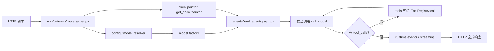
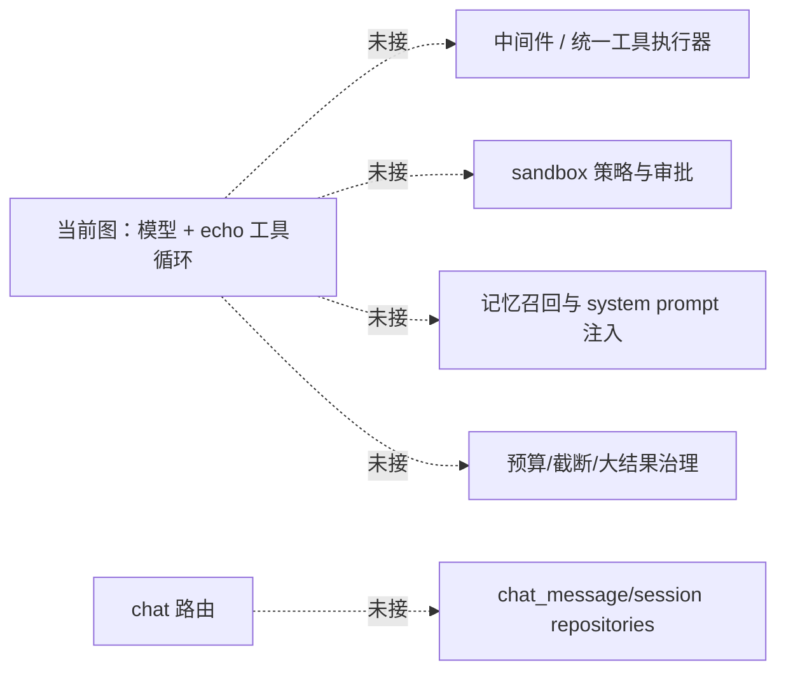

# myagentflow 代码结构导览

本图按**当前仓库实际文件**整理。模块存在不代表功能完整；虚线表示计划中的调用而非已接通行为。详细逐章映射见 Agent-Book 的《总文档、分章与代码落地对照》。

## 一眼看懂分层

```text
backend/
├── app/                         应用入口：Gateway、HTTP 路由、渠道
│   ├── gateway/                 FastAPI 服务与少量 API 路由
│   └── channels/                渠道基类（具体 IM 渠道未落地）
├── packages/harness/myagentflow/ 核心能力包（不依赖 app.*）
│   ├── config/、models/         配置加载、模型解析与构造
│   ├── agents/                  单轮/工具循环 Lead Agent、检查点、中间件组件
│   ├── tools/                   工具注册、echo、宿主工具与结果治理组件
│   ├── runtime/                 运行事件与流式投影
│   ├── persistence/             SQLite 连接、会话与消息仓储
│   ├── session_execution/       运行状态与幂等组件
│   ├── context/、memory/        预算与记忆组件
│   ├── knowledge/、code_index/  文档知识与工作区代码索引组件
│   ├── plans/、collab/          Plan/Workflow 子集、协作账本与分享
│   ├── subagents/、sandbox/     子代理与执行策略/审批子集
│   ├── automation/              自动化存储/调度/心跳/通知子集
│   ├── mcp/、skills/            MCP 客户端与 Skills 加载/注册子集
│   ├── authz/、observability/、eval/ 身份治理、Trace、评测子集
│   ├── app_server/、webui/、cli/ stdio、UI RPC 与 CLI
│   └── uploads/                 当前仅有包入口，上传实现未落地
└── tests/chapters/              按学习章节组织的离线行为测试
```

## 当前已接线的最小请求链



当前已接的最小闭环是：`/api/chat` → checkpointer → 图（模型 + echo 工具循环） → SSE。它不是完整 AgentRuntime：没有 system prompt 组装、统一工具执行器、中间件、审批、消息表读写、记忆注入和预算。

下面这些仍是**组件已存在但尚未由聊天图接通**：



已知边界（依据分章实现状态与 `00-导论/05-完整度审计`）：

- `agents/lead_agent/graph.py` 已有可选工具循环：`tool_calls → tools 节点 → ToolMessage → 再调用模型`，并有最大轮次；但 `chat` 只注册了 `echo`，还没有统一 ToolExecutor。
- 工具失败会以 `ERROR: ...` 回灌给模型，不会打断整轮；中间件、审批、审计尚未接进这条链。
- `chat` 路由已传 `get_checkpointer()`，同 thread 第二轮会带历史；但消息仓储仍未读写，检查点与消息表不是同一份事实源。
- 记忆、上下文预算、middleware、后台任务和大型输出治理均有章节级组件，但尚未串入 Agent 的实际工具运行路径。
- `app/channels/` 当前只有基类；不存在本项目 Web 前端/Tauri 实现。

## persistence 目录结构

```text
persistence/
├── db.py                          共享 SQLite 连接、锁、建表
├── session_repositories.py        sessions 表读写
└── chat_message_repositories.py   chat_messages 表读写
```

仓储组件面向 `thread_id`/`session_key`，但当前聊天入口尚未调用它们。不能因仓储文件存在，就把请求链画成已持久化。
## 常用文件速查

| 想找什么 | 从这里开始 | 当前边界 |
|---|---|---|
| 配置入口 | `config/app_config.py` | 组件有测试 |
| 模型解析/创建 | `models/resolver.py`、`models/factory.py` | 组件有测试 |
| Agent 图 | `agents/lead_agent/graph.py` | 可选工具循环；chat 只注册 echo，无统一执行器 |
| 工具注册 | `tools/registry.py` | 注册/echo 组件；已被图调用，但只在最小工具集 |
| SQLite 连接 | `persistence/db.py` | 与会话/消息仓储同库 |
| 会话/消息读写 | `persistence/session_repositories.py`、`chat_message_repositories.py` | 路由未接入 |
| 运行事件 | `runtime/events.py`、`runtime/streaming.py` | 最小事件投影；断线恢复不完整 |
| HTTP 聊天入口 | `app/gateway/routers/chat.py` | 已接 checkpointer + echo 工具循环 |
| 按章验收 | `tests/chapters/test_ch*.py` | 文件存在不代表本轮已重跑；看 PROGRESS 的日期命令记录 |

## 阅读建议

从 `app/gateway/routers/chat.py` 沿当前真实请求追到模型、checkpointer 和最小工具循环；组件学习时再分别检查仓储、生命周期、记忆和知识模块。先以分章状态表核对“已实现/已测试/已接线”各自含义，再阅读相应章节；不要把文件树误当完整产品架构。
