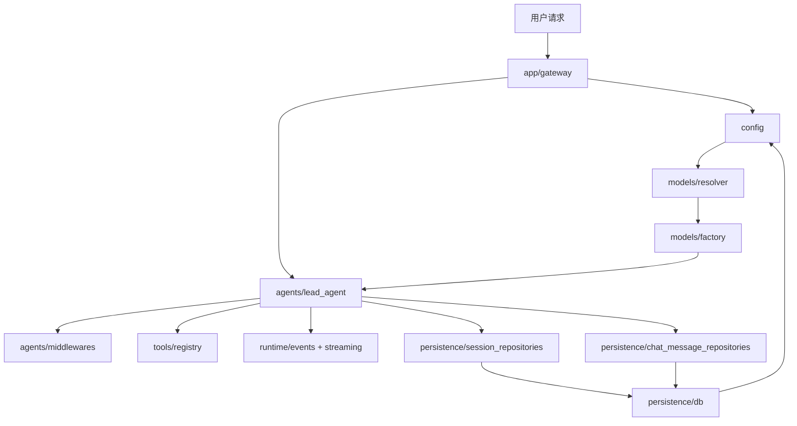

# myagentflow 代码结构导览

本图按**当前仓库实际文件**整理，帮助快速定位职责与调用方向。它描述的是仿写项目现状，不代表所有模块已完成或与 EvoFlow 行为完全一致。尚未进入学习章节的模块只标注职责，不意味着应提前扩展实现。

## 一眼看懂分层

```text
backend/
├── app/                         应用入口：Gateway、HTTP 路由、渠道
│   ├── gateway/                 FastAPI 服务与 API 路由
│   └── channels/                外部消息渠道适配
├── packages/harness/myagentflow/ 核心能力包（不依赖 app.*）
│   ├── config/                  配置模型、加载与存储配置
│   ├── models/                  模型选择与 Provider 构造
│   ├── agents/                  Lead Agent、子能力、中间件、检查点
│   ├── tools/                   工具注册、内置工具、宿主直连工具
│   ├── runtime/                 运行事件与流式映射
│   ├── persistence/             SQLite 连接、会话与消息仓储
│   ├── session_execution/       运行状态、生命周期、幂等
│   ├── context/                 上下文预算
│   ├── memory/                  Agent 记忆与资产
│   ├── knowledge/               文档切块、向量检索、知识地图
│   ├── code_index/              Workspace 代码索引
│   ├── plans/                   Plan 解析、路由与 Workflow
│   ├── collab/                  协作账本与分享
│   ├── subagents/               子 Agent 注册、适配与汇总
│   ├── sandbox/                 执行策略与审批
│   ├── automation/              自动化存储、调度、心跳与通知
│   ├── mcp/、skills/            外部工具协议与技能加载
│   ├── authz/                   ACL、JWT、License
│   ├── observability/、eval/    Trace 与质量评估
│   ├── app_server/、webui/、cli/ 服务协议、UI RPC 与命令行入口
│   └── uploads/                 上传能力（按章节逐步实现）
└── tests/chapters/              按学习章节组织的验收测试
```

## 核心请求链路



## persistence 目录结构（第 1.3 章范围）

```text
persistence/
├── __init__.py
├── db.py                          # 连接与锁：get_db / db_connection_lock / reset_db
├── session_repositories.py        # sessions 表：upsert_session_row 等 4 个函数
└── chat_message_repositories.py   # chat_messages 表：append_message 等 4 个函数
```

```text
chat 路由 ──→ session_repositories ─┐
        └──→ chat_message_repositories ─┼──→ db ──→ config/app_config.storage
                                        └──→ db（同一个 get_db 单例）
```

- `db.py` 只认库文件路径（`storage.sqlite_path` 或测试用的 `MYAF_DB_PATH`），不认业务参数。
- 两个仓储只认 `thread_id`（= `session_key`），不认路由或 HTTP 结构；换调用方不用改仓储。
- 表：`sessions(session_key, title, created_at, updated_at)`、`chat_messages(thread_id, seq, role, content, created_at)`，主键 `(thread_id, seq)`。

## 常用文件速查

| 想找什么 | 从这里开始 | 职责 |
|---|---|---|
| 应用配置入口 | `config/app_config.py` | 配置根对象、读取与缓存 |
| 模型怎么选 | `models/resolver.py` | 解析本轮模型来源 |
| 模型怎么创建 | `models/factory.py` | 按配置实例化 Provider |
| Agent 图 | `agents/lead_agent/graph.py` | 当前仿写的 Lead Agent 图入口 |
| 工具怎么注册 | `tools/registry.py` | 工具定义、schema 与调用 |
| SQLite 连接 | `persistence/db.py` | 共享连接、锁、WAL 与建表入口 |
| 会话/消息读写 | `persistence/session_repositories.py`、`chat_message_repositories.py` | 面向业务的仓储操作 |
| 运行事件 | `runtime/events.py`、`runtime/streaming.py` | 统一事件对象与流式投影 |
| HTTP 聊天入口 | `app/gateway/routers/chat.py` | API 层接收请求并调用核心包 |
| 按章验收 | `tests/chapters/test_ch*.py` | 对应章节的离线行为验证 |

## 阅读建议

从 `app/gateway/routers/chat.py` 沿请求往下追到 Agent，再分别跟模型、工具、事件和仓储；读持久化时从 `db.py` 看连接管理，再向上看 repositories。按学习规划推进时，只深入当前章节涉及的模块，其余目录先作为地图，不提前实现。
